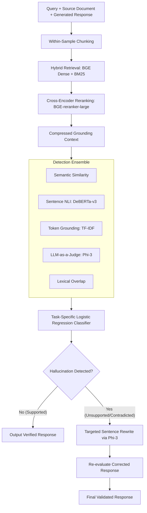

# 🧠 Self-Correcting RAG: Hallucination Detection & Correction

[](https://www.python.org/)
[](https://pytorch.org/)
[](https://huggingface.co/)
[](https://github.com/ParticleMedia/RAGTruth)

An end-to-end framework for detecting and correcting factual hallucinations in Retrieval-Augmented Generation (RAG) responses across Question Answering, Summarization, and Data-to-Text tasks using the **RAGTruth** benchmark dataset.

---

## 🌟 Key Highlights

- **🔒 Within-Sample Retrieval Architecture**: Unlike standard RAG benchmarks that risk cross-sample context leakage, each response is grounded strictly against its sample's own source documents using Hybrid Retrieval (Dense BGE-base + Sparse BM25) and Cross-Encoder Re-Ranking (`BAAI/bge-reranker-large`).
- **🔬 5-Signal Ensemble Detection**: Combines multi-perspective signals for fine-grained factual verification:
  1. **Semantic Similarity**: Dense cosine distance between generated response and retrieved context chunks (`BAAI/bge-base-en-v1.5`).
  2. **Sentence-Level NLI**: Natural Language Inference (`DeBERTa-v3-large` fine-tuned on MNLI/FEVER/ANLI) evaluating entailment vs. neutral vs. contradiction.
  3. **Lexical & Token Grounding**: TF-IDF token coverage measuring token retention from context.
  4. **LLM-as-a-Judge**: Prompted factual verification using `microsoft/Phi-3-mini-4k-instruct`.
  5. **Lexical Overlap**: Word and n-gram overlap between generated output and source evidence.
- **📐 Task-Specific Calibration**: Implements task-specialized Logistic Regression classifiers with Platt probability calibration tailored to QA, Summarization, and Data-to-Text error dynamics.
- **🔧 Targeted Sentence-Level Correction**: Selectively rewrites contradicted or unsupported sentences using `Phi-3-mini`, verifying whether the corrected revision improves grounding scores without introducing new hallucinations.

---

## 🏗️ System Architecture



---

## 📊 Experimental Results

Evaluated on the **RAGTruth** balanced test benchmark ($N = 200$ samples: 100 hallucinated, 100 grounded):

### Overall Pipeline Performance
| Metric | Score | Performance Bar |
|---|---|---|
| **Accuracy** | **0.6400** | `███████████████████░░░░░░░░░░░` |
| **Precision** | **0.6014** | `██████████████████░░░░░░░░░░░░` |
| **Recall** | **0.8300** | `████████████████████████░░░░░░` |
| **F1-Score** | **0.6975** | `████████████████████░░░░░░░░░░` |
| **ROC-AUC** | **0.5692** | `█████████████████░░░░░░░░░░░░░` |

### Per-Task Breakdown
| Task Type | Samples ($N$) | Accuracy | Precision | Recall | F1-Score |
|---|---|---|---|---|---|
| **Data2txt** | 83 | **0.675** | **0.688** | **0.965** | **0.803** |
| **QA** | 53 | **0.679** | 0.440 | **0.786** | 0.564 |
| **Summary** | 64 | 0.562 | 0.515 | 0.586 | 0.548 |

> **Correction Verification**: 100% (2/2) of samples that triggered the conservative correction threshold demonstrated verifiable improvements in composite grounding scores post-rewrite.

---

## 📁 Repository Structure

```text
├── RAGTruth_Final_v4_(1).ipynb   # Main end-to-end pipeline notebook
├── requirements.txt              # Python package dependencies
├── .gitignore                    # Git ignore file for datasets and caches
└── README.md                     # Project documentation & benchmark report
```

---

## 🚀 Quickstart & Setup

### 1. Prerequisites
- Python 3.10+
- An NVIDIA GPU with at least 8 GB VRAM is recommended (e.g., T4 on Google Colab or RTX 3060/4060+). CPU execution is supported but significantly slower.

### 2. Installation
Clone the repository and install the required dependencies:

```bash
git clone https://github.com/<your-username>/<your-repo-name>.git
cd <your-repo-name>
pip install -r requirements.txt
```

### 3. Running the Pipeline
Open the notebook in Jupyter Lab or Google Colab:

```bash
jupyter notebook "RAGTruth_Final_v4_(1).ipynb"
```

The notebook automatically clones the RAGTruth repository, parses the source contexts and responses, loads the required pre-trained weights from Hugging Face, calibrates the task classifiers, and executes the evaluation and correction pipeline.

---

## 📜 Acknowledgements & References

- **Dataset**: [RAGTruth Benchmark](https://github.com/ParticleMedia/RAGTruth) for ground-truth hallucination annotations.
- **Models**: Hugging Face community for pre-trained weights (`BAAI/bge-base-en-v1.5`, `BAAI/bge-reranker-large`, `MoritzLaurer/DeBERTa-v3-large`, and `microsoft/Phi-3-mini-4k-instruct`).

---

## 📄 License

This project is licensed under the MIT License - see the LICENSE file for details.

